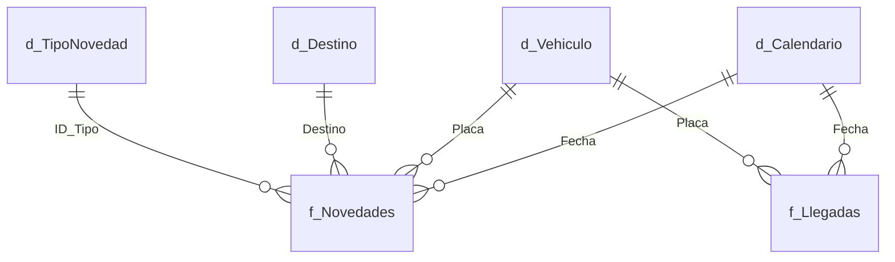

# Guía de Modelado, Power Query y DAX

> **Proyecto:** Power BI Quality Operations  
> **Propósito:** Procedimientos detallados de transformación de datos (ETL), diseño de modelo relacional en estrella y validación contextual de medidas.

---

## 1. Power Query: Transformación y Calidad de Datos

### Anexar vs. Combinar Consultas
> [!IMPORTANT]
> **Nunca anexar sin comparar granularidad:**
> * **Anexar Consultas (Append):** Coloca filas de una tabla debajo de otra (Unión SQL). Requiere que ambas tablas representen **el mismo evento** y tengan columnas compatibles (ej. Base Nacional y Base Regional con mismas columnas de Novedades).
> * **Combinar Consultas (Merge):** Hace un JOIN horizontal entre dos tablas mediante una columna clave coincidente (ej. Cruzar Novedades con la tabla de Maestros de Vehículos para traer Tipo de Camión o Conductor).

* Referencia Oficial Microsoft:
  * [Anexar consultas en Power Query](https://learn.microsoft.com/es-es/power-query/append-queries)
  * [Combinar consultas en Power Query](https://learn.microsoft.com/en-us/power-query/merge-queries-overview)

### Plantilla de Pasos M Recomendados para Limpieza:
1. **Promover Encabezados:** Asegurar que la primera fila no quede como datos.
2. **Eliminar Espacios en Blanco:** Aplicar `Text.Trim` y `Text.Clean` en columnas de texto como `Placa`, `Transferencia`, `Destino`.
3. **Mayúsculas Consistentes:** Convertir `Placa` a mayúsculas para evitar que `xyz-123` y `XYZ-123` se traten como camiones distintos.
4. **Tipos de Datos Explícitos:** 
   * Fechas: `type date` (evitar que quede como `text` o `datetime` si no se necesita la hora).
   * Cantidades: `Int64.Type` o `type number`.
   * Identificadores/Placas: `type text`.

---

## 2. Detección Segura de Duplicados

No use la opción "Quitar Duplicados" a ciegas sobre toda la tabla:
* **Duplicado Real:** Toda la fila es exactamente idéntica (error de copia/pega manual en el Excel origen). Se puede quitar.
* **Evento Múltiple Legítimo:** Una misma placa y fecha aparece 4 veces porque transportó 4 pedidos o tuvo 4 tipos de productos averiados diferentes. Si se quitan duplicados por placa, **se perderá el 75% de las novedades reales**.

---

## 3. Arquitectura del Modelo de Datos

Recomendamos estructurar el modelo siguiendo el esquema en estrella (*Star Schema*):

### Reglas de Relaciones:
* **Cardinalidad:** 1 a Varios (`1:*`) desde las tablas de dimensiones (`d_`) hacia las tablas de hechos (`f_`).
* **Dirección de Filtro Cruzado:** **Única** (*Single*). Evitar relaciones bidireccionales (`Both`), ya que causan ambigüedad y cálculos erróneos en DAX.
* **Relaciones Muchos a Muchos (`*:*`):** Si detecta que al unir dos tablas Power BI le propone una relación `*:*`, deténgase: significa que no ha creado una tabla intermedia de dimensiones con valores únicos.
