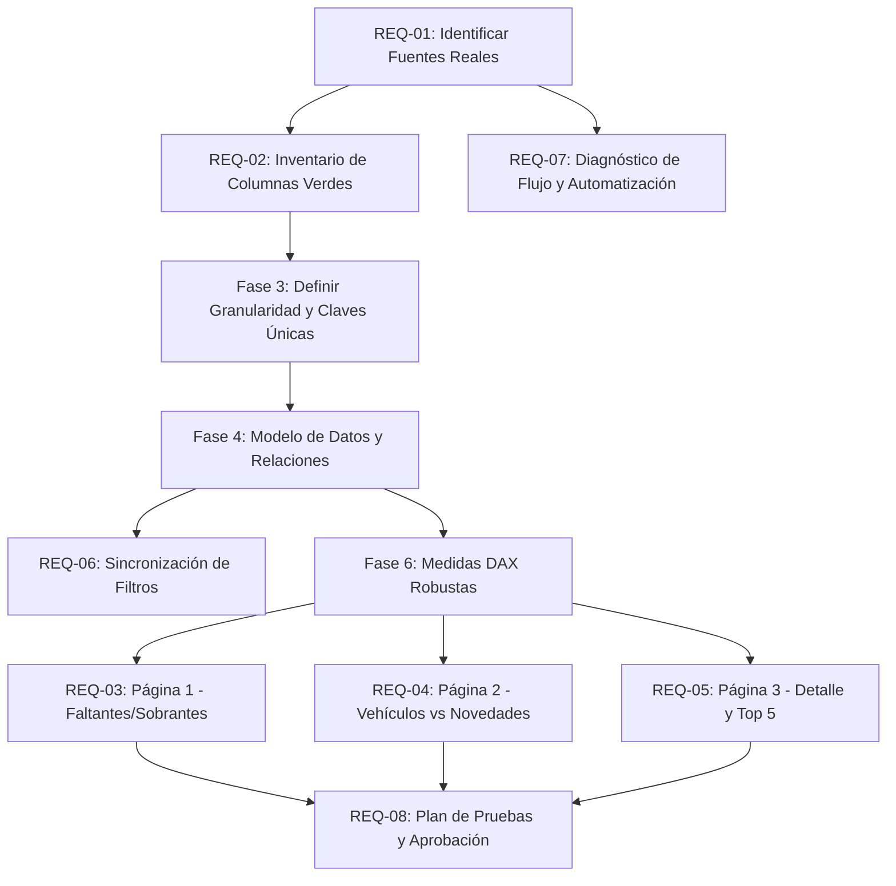

# Matriz de Requerimientos y Trazabilidad

> **Proyecto:** Power BI Quality Operations — Dashboard de Gestión de Calidad  
> **Propósito:** Mapeo exhaustivo de necesidades operativas, estado de certeza, dependencias técnicas y pruebas de validación.

---

## 1. Clasificación por Nivel de Certeza

| Requerimiento | Descripción Funcional | Nivel de Certeza | Lo que se Sabe | Lo que Falta Validar en la Empresa |
| :--- | :--- | :---: | :--- | :--- |
| **REQ-01: Fuentes de Datos** | Conexión e integración de datos nacionales y regionales (Cartagena). | **Incertidumbre Alta** | Históricamente eran dos archivos Excel con datos de novedades y transferencias. | ¿Siguen siendo Excel locales o están en SharePoint Online (Biblioteca o Listas)? URL del sitio y credenciales. |
| **REQ-02: Columnas Nuevas (Verde)** | Incorporar campos marcados visualmente en verde en el origen. | **Incertidumbre Media** | Existen campos añadidos recientemente para enriquecer el control operacional. | Nombres exactos de las columnas, tipos de datos, si vienen del origen o se calculan en Power Query. |
| **REQ-03: Faltantes y Sobrantes (Pág 1)** | Tarjetas y evolución temporal de cantidades y porcentajes de averías/sobrantes. | **Confirmado en Alcance** | Se requiere ver volumen de piezas/unidades y su proporción respecto al total. | ¿Cuál es el denominador oficial? ¿Total unidades despachadas, recibidas o pedidos? Regla para julio. |
| **REQ-04: Vehículos vs Novedades (Pág 2)** | Comparativa de vehículos que llegaron frente a los que presentaron novedades. | **Confirmado en Alcance** | Diferenciar claramente volumen total de llegadas vs viajes con incidencias. | ¿Qué define una llegada única? ¿Placa sola o combinación Placa + Fecha + Nro Transferencia? |
| **REQ-05: Detalle y Top 5 (Pág 3)** | Detalle por Placa, Transferencia, Pedido, Entrega y Ranking de 5 vehículos críticos. | **Confirmado en Alcance** | Visualización tabular exhaustiva con navegación y ranking de los 5 más incidentes. | ¿El Top 5 se ordena por conteo de novedades, unidades afectadas o número de viajes con falla? |
| **REQ-06: Sincronización de Filtros** | Sincronizar segmentadores (Placa, Fecha, Operación, Destino) entre páginas 1, 2 y 3. | **Confirmado en Alcance** | Actualmente los filtros de una página no afectan a las demás de forma coherente. | Qué segmentadores deben sincronizarse globalmente y cuáles deben ser locales de página. |
| **REQ-07: Automatización del Flujo** | Reducir el proceso manual de copiar, pegar y consolidar en la base de novedades. | **Incertidumbre Media** | El proceso actual depende de consolidación manual en hojas de cálculo. | Permisos de usuario en M365/Power Automate, licencias y si los archivos están centralizados. |
| **REQ-08: Validación y Pruebas** | Verificación cruzada entre cifras de Power BI y libros de origen. | **Confirmado en Alcance** | Se requiere conciliar los KPIs antes de publicar o compartir el reporte. | Quién es el usuario líder de Calidad que valida y aprueba las cifras oficiales. |

---

## 2. Matriz de Dependencias Técnicas

---

## 3. Glosario de Entidades de Negocio y Reglas Críticas

> [!IMPORTANT]
> **No confundir granularidades:** Un error común en este proyecto es sumar filas creyendo que son entregas, o contar placas únicas creyendo que son viajes realizados.

1. **Vehículo (Placa):** La unidad física de transporte (ej. `XYZ-123`). Puede realizar 20 viajes en un mes. Contar placas únicas = cuántos camiones distintos participaron.
2. **Llegada / Viaje:** El evento operacional de arribo a la planta o centro de distribución. Habitualmente identificado por `Placa + Fecha + Nro Transferencia` o un ID de Manifiesto.
3. **Transferencia:** El documento o registro de traslado de mercancía entre plantas o almacenes. Puede incluir múltiples pedidos y entregas.
4. **Pedido:** Orden de suministro o venta. Puede despacharse en una o varias entregas.
5. **Entrega (Delivery):** La unidad logística de recepción en destino. Debe identificarse si existe una columna `ID_Entrega` o si se deriva.
6. **Novedad:** La discrepancia registrada (Faltante, Avería, Sobrante, Daño). Una misma entrega puede registrar una novedad de faltante de 2 cajas y otra de daño de 1 caja.
